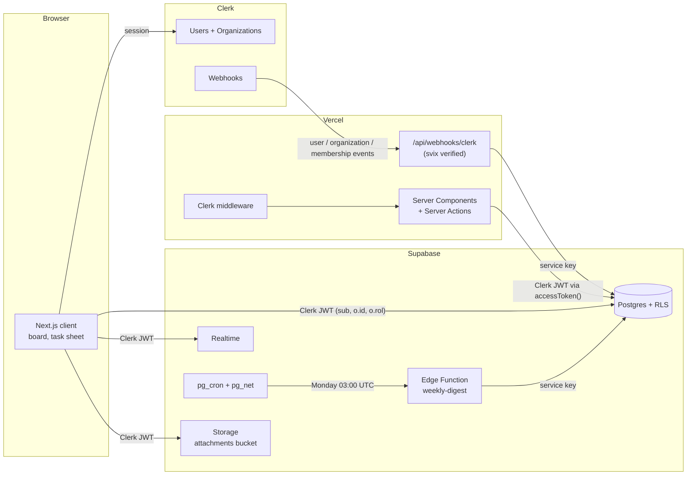

# TeamBoard

A multi-tenant team workspace (projects, a realtime task board, comments, file attachments and a weekly digest) built to show how **Clerk**, **Supabase** and **Vercel** fit together when tenant isolation is enforced by Postgres instead of application code.

- **Live:** LIVE_URL_PLACEHOLDER
- **Author:** [Arpit Meena](https://arpitm.me)

> Status: the Vercel deployment runs, and until Clerk and Supabase keys are added it shows a "not configured" checklist instead of the workspace. The setup section below lists every step.

## Stack

| Layer | What it does |
| --- | --- |
| **Clerk** | Sign-in, Organizations (admin/member roles, invitations, org switcher), session tokens, webhooks |
| **Supabase** | Postgres with Row Level Security, Clerk as a third-party auth provider, Realtime, Storage, Edge Functions, pg_cron |
| **Next.js 15 (App Router)** | Server Components, Server Actions, ISR for the landing page, Clerk middleware, webhook route handler |
| **Vercel** | Hosting, Web Analytics, Speed Insights |
| **UI** | Tailwind CSS 4 and shadcn/ui |

## Architecture



**One token, three platforms.** The Clerk session token is the only credential the browser and the server send to Supabase. With the Clerk ↔ Supabase integration enabled, Clerk adds `role: "authenticated"` to its session token, and Supabase verifies it against Clerk's JWKS because Clerk is registered as a third-party auth provider. supabase-js gets the token through the `accessToken` option:

```ts
createClient(url, publishableKey, {
  accessToken: async () => (await auth()).getToken(), // server
});
```

**Webhooks sync, but don't authorize.** Clerk webhooks (`user.*`, `organization.*`, `organizationMembership.*`) are verified with svix and mirrored into `profiles`, `organizations` and `memberships`. These tables are used for display (names, avatars, assignee lists) and to check that an assignee belongs to the org. Authorization never depends on them: it uses the claims in the token, so a delayed webhook can't grant or revoke access.

## Row Level Security

Every table has RLS enabled, `anon` has no grants, and `authenticated` only gets the privileges each table needs. Policies call small SQL helpers that live in a `private` schema, which is not exposed through the API:

```sql
-- active org from Clerk session token v2 ("o.id") or v1 ("org_id")
create function private.active_org_id() returns text language sql stable as $$
  select nullif(coalesce(auth.jwt() -> 'o' ->> 'id', auth.jwt() ->> 'org_id'), '');
$$;

create policy "Members read tasks" on public.tasks
  for select to authenticated
  using ((select private.is_org_member(org_id)));

create policy "Members create tasks" on public.tasks
  for insert to authenticated
  with check ((select private.is_org_member(org_id))
              and created_by = (select private.clerk_user_id()));
```

`is_org_member(org)` is true only when the token has `role = authenticated` and its active org equals `org`. `is_org_admin` also requires the org role to be `admin` (Clerk's `org:admin` is normalised).

| Action | Who |
| --- | --- |
| Read anything in an org | Members whose **active** org (in the token) is that org |
| Create / edit / archive projects | Admins |
| Create and edit tasks | Members (`created_by` must be the caller) |
| Delete a task | Admins, or the task's creator |
| Comments and attachments | Members add them as themselves; admins or the author delete |
| `organizations`, `memberships`, `profiles`, `activity_log`, `digests` | Read-only for users; written by webhooks, triggers or the Edge Function |

Defence in depth beyond the policies:

- `org_id` and `created_by` default to the token's values, and a trigger stops them from being changed after insert.
- Composite foreign keys `(project_id, org_id)` and `(task_id, org_id)` make it impossible to reference a row in another tenant.
- A trigger checks that a task's assignee is a member of the task's org.
- `activity_log` is written only by a `security definer` trigger, so users can't forge history.
- Storage objects live at `<org_id>/<task_id>/<file>` in a private bucket. Storage policies check the first path segment against the active org and that the task exists in that org; deletes are limited to admins or the uploader.

## Features

- **Organizations:** create or switch orgs with Clerk's `OrganizationSwitcher`, invite people and manage roles in `OrganizationProfile` (`/app/team`).
- **Projects:** admins create and archive projects; the dashboard shows progress per project.
- **Realtime board:** a kanban board subscribed to `postgres_changes` on `tasks`. Realtime applies the same RLS, so each client only receives its own org's changes. Drag tasks across columns; changes appear for other members without a refresh.
- **Task details:** status, priority, assignee, due date, description, comments (also realtime) and file attachments (Supabase Storage, signed download URLs).
- **Activity feed:** every create, status change, assignment, comment and file upload is logged by triggers.
- **Weekly digest:** `pg_cron` calls the `weekly-digest` Edge Function every Monday at 03:00 UTC through `pg_net`, authenticated with a shared secret stored in Supabase Vault. The function writes a per-org summary (`digests` table) shown on the dashboard.

## Tests

```bash
npm test          # Vitest: unit tests + RLS tests
npm run db:test   # pgTAP against the local Supabase stack (needs Docker)
```

- **RLS tests (Vitest + PGlite):** `src/test/rls.test.ts` loads the real migrations and seed into an in-process Postgres ([PGlite](https://pglite.dev)) with a small shim for Supabase's roles and `auth.jwt()`, then runs queries as different Clerk users. They cover cross-tenant reads and writes, forged tokens, Clerk v1 and v2 claim shapes, admin-only actions, immutable ownership columns and trigger behaviour. No Docker needed.
- **pgTAP:** `supabase/tests/database/rls.test.sql` checks the same isolation rules against a real Supabase database.
- **Unit tests:** webhook verification and the sync plan (`src/lib/clerk-sync.test.ts`), task helpers and validation, and the digest logic (`supabase/functions/weekly-digest/lib.test.ts`).

`npm run check` runs lint, type-check and tests.

## Setup

### 1. Local

```bash
npm install
cp .env.example .env.local
npm run dev
```

Without keys the app runs and `/app` shows which environment variables are missing.

For a local database, set `CLERK_DOMAIN` and run `npm run db:start` (Supabase CLI + Docker). Migrations and `supabase/seed.sql` (two fictional orgs) are applied automatically.

### 2. Clerk

1. Create an application in the [Clerk dashboard](https://dashboard.clerk.com).
2. **Organizations:** enable them (Configure → Organizations). Keep the default `admin` and `member` roles. TeamBoard is org-only, so turn off personal accounts if you can.
3. **Supabase integration:** open [dashboard.clerk.com/setup/supabase](https://dashboard.clerk.com/setup/supabase), choose the app and **Activate Supabase integration**. This adds `role: "authenticated"` to session tokens. Copy the **Clerk domain** it shows.
4. **Webhook:** Configure → Webhooks → Add endpoint
   - URL: `https://<your-deployment>/api/webhooks/clerk`
   - Events: `user.created`, `user.updated`, `user.deleted`, `organization.created`, `organization.updated`, `organization.deleted`, `organizationMembership.created`, `organizationMembership.updated`, `organizationMembership.deleted`
   - Copy the signing secret into `CLERK_WEBHOOK_SIGNING_SECRET`.
5. Copy the API keys into `NEXT_PUBLIC_CLERK_PUBLISHABLE_KEY` and `CLERK_SECRET_KEY`.

### 3. Supabase

Create a project, then either run the provisioning script:

```bash
SUPABASE_ACCESS_TOKEN=... SUPABASE_PROJECT_REF=... CLERK_DOMAIN=... npm run provision
```

It applies the migrations, registers Clerk as a third-party auth provider, creates the Vault secrets for the cron job, deploys the Edge Function and prints the project URL and publishable key. Or do it by hand:

1. `supabase link --project-ref <ref>` and `supabase db push`.
2. Authentication → Sign In / Providers → **Third-Party Auth** → add **Clerk** with the Clerk domain.
3. In the SQL editor, create the Vault secrets the cron job reads:
   ```sql
   select vault.create_secret('https://<ref>.supabase.co', 'project_url');
   select vault.create_secret('<random string>', 'digest_cron_secret');
   ```
4. `supabase secrets set DIGEST_CRON_SECRET=<same random string>` and `supabase functions deploy weekly-digest`.
5. Copy the project URL, publishable key and secret key into the environment variables below.

### 4. Vercel

Import the repo and set:

| Variable | Notes |
| --- | --- |
| `NEXT_PUBLIC_CLERK_PUBLISHABLE_KEY`, `CLERK_SECRET_KEY` | Clerk API keys |
| `CLERK_WEBHOOK_SIGNING_SECRET` | From the webhook endpoint |
| `NEXT_PUBLIC_SUPABASE_URL`, `NEXT_PUBLIC_SUPABASE_PUBLISHABLE_KEY` | Supabase project URL and publishable key |
| `SUPABASE_SECRET_KEY` | Server-only; used by the webhook route |
| `NEXT_PUBLIC_SITE_URL` | The deployment URL |

Analytics and Speed Insights are already in the root layout; enable them in the Vercel project.

## Project layout

```
src/app/                 landing page (ISR), /app workspace, webhook route, server actions
src/components/app/      board, task sheet, dialogs, activity list
src/lib/                 Supabase clients, Clerk sync, validation, task helpers
supabase/migrations/     schema, RLS, realtime + storage, cron
supabase/functions/      weekly-digest Edge Function
supabase/tests/          pgTAP tests
src/test/                PGlite RLS harness
scripts/                 Supabase provisioning
```

## License

MIT
